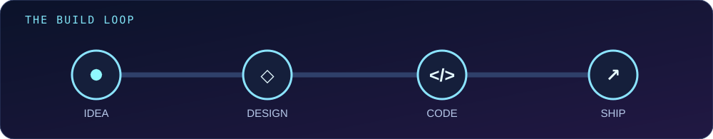

 

---

### `> about_me.exe`

I'm **Pranav MK**, a first-year **B.Tech Artificial Intelligence & Data Science** student based in Chennai, India.

I build at the intersection of **AI engineering, web design, useful automations, and digital marketing**. I care about turning ambitious ideas into projects people can actually try.

- 🤖 **AI & agents:** LLM-powered workflows, coding assistants, practical AI tools
- 🌐 **Web & design:** responsive interfaces, interactive experiences, developer tools
- ⚡ **Automation:** simplifying repetitive work
- 📈 **Marketing:** SEO, performance marketing, product growth
- 🛠️ **My mindset:** learn in public → prototype → iterate → ship

### `> tech_stack.json`

Technologies I'm using or exploring — always learning more.

### `> currently_exploring`

| Project direction | Mission |
| :--- | :--- |
| 🤖 **LinkedIn AI Agent** | Research topics, draft posts, request approval, and publish using authorized integrations |
| 🧩 **AgentSkill Hub** | Build reusable skills for AI coding assistants |
| 🎓 **Campus Tools** | Simplify student timetables, clubs, events, and hackathons |
| 📊 **OpenMarketing** | Create practical, open-source SEO and marketing utilities |

These are areas I'm exploring, not claims of released repositories. I'll link source code and demos as I publish them.

### `> github_activity`

---

### ✨ Let's build something useful

**Creative code · AI agents · open source · intelligent automation**

[**Connect with me on LinkedIn**](https://www.linkedin.com/in/pranav-mk-52713a402/)

Thanks for visiting — keep building, keep experimenting 🚀

